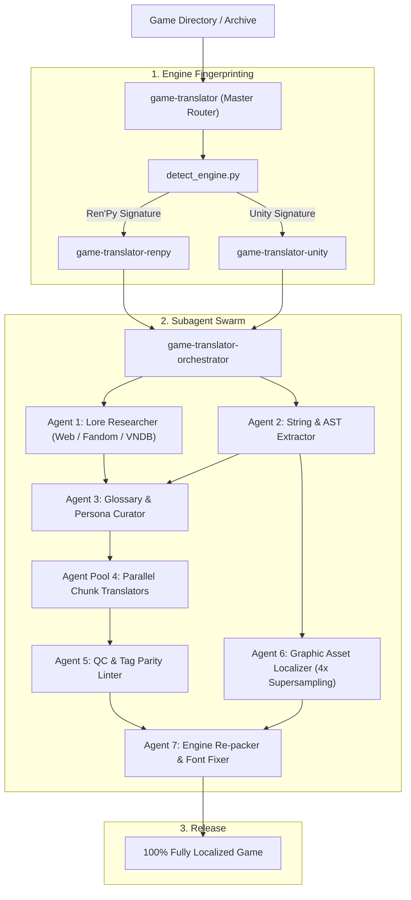

# Game Translator Skills 🎮🌐

[](https://opensource.org/licenses/MIT)
[](https://www.python.org/)
[](#supported-engines)

An enterprise-grade, extensible AI skill system designed for **Antigravity** and autonomous coding agents to localize video games into **Vietnamese** (and other target languages) with human-grade quality, deep engine hooks, anti-sanitization preservation, and parallel subagent orchestration.

---

## 🌟 Key Pillars & Standards

1. **Strict Human-Grade Translation**: Zero tolerance for dry, literal machine translation (Google Translate / DeepL style). Lively, genre-fitting Vietnamese phrasing tailored to visual novels, RPGs, and detective mysteries.
2. **Anti-Sanitization Directive**: Respects original author intent, characters' raw personalities, swearing, slang, and adult/eroge dialogue without euphemistic toning down.
3. **Lore-First Reconnaissance**: Proactively searches web, fandom wikis, and VNDB to build a comprehensive `LORE_CONTEXT.json` and Persona Matrix (pronouns, relationships, speaking styles) before translating.
4. **Subagent Orchestration**: Automatically divides large dictionaries into batches for parallel translation workers, audited by automated QC and rich text tag linters.
5. **Technical Engine Integrity**:
   - Zero-tolerance for **Font Tofu (`[?]`)**: Automatically audits 146 Vietnamese Unicode glyphs and patches font fallbacks.
   - 100% preservation of escape tags: `{b}`, `{color}`, `[var]`, `<sprite=0>`, `<voffset>`.
   - AAA Graphic Asset Localization: Inpainting with 4x supersampling, multi-layer outlines, and alpha channel preservation.

---

## 🏗️ System Architecture



---

## 📂 Repository Structure

- **`game-translator/`**: Master skill router, engine classifier, lore research generator, and pipeline orchestrator.
- **`game-translator-renpy/`**: Ren'Py specialized engine skill (RPA unpacker, AST python string extractor, font tofu auditor, Vietnamese tl layer generator, and bytecode compiler).
- **`game-translator-unity/`**: Unity specialized engine skill (Mono vs IL2CPP profiler, batch slicer, dictionary compiler, TSV reviewer, TextMeshPro rich text linter, and BepInEx hook templates).
- **`shared/`**: Universal tools (glossary builder, 4x supersampling graphic inpainter, universal QC linter, and bundled 100% Unicode Vietnamese fonts).

---

## 🚀 Installation into Antigravity

Copy the skills to your Antigravity skills directory (`~/.gemini/config/skills`):

```bash
# In Windows PowerShell:
$skillsDir = "$HOME\.gemini\config\skills"
Copy-Item -Path "game-translator", "game-translator-renpy", "game-translator-unity" -Destination $skillsDir -Recurse -Force
```

---

## 📖 Quick Start

### 1. Master Pipeline Bootstrap
```bash
python game-translator/scripts/orchestrate_pipeline.py "D:/Games/MyGame" --name "MyGame"
```

### 2. Ren'Py Extraction & Font Tofu Audit
```bash
# Extract RPA archive
python game-translator-renpy/scripts/extract_rpa.py "D:/Games/RenpyGame/game/archive.rpa" --out "D:/Games/RenpyGame/scratch"

# Audit fonts for tofu boxes
python game-translator-renpy/scripts/audit_fonts.py "D:/Games/RenpyGame/scratch/fonts"

# Extract hidden Python/Live2D strings
python game-translator-renpy/scripts/extract_python_strings.py "D:/Games/RenpyGame/game"
```

### 3. Unity Batching & Rich Text Audit
```bash
# Slice dialogue into chunks of 250 entries for parallel subagents
python game-translator-unity/scripts/slice_and_batch.py "D:/Games/UnityGame/raw_dialogue.json" --size 250

# Audit TextMeshPro rich text tags
python game-translator-unity/scripts/verify_unity_rich_text.py "D:/Games/UnityGame/translations/dialogue.json"
```

---

## 📜 License

MIT License. Crafted with precision for high-caliber game localization.
